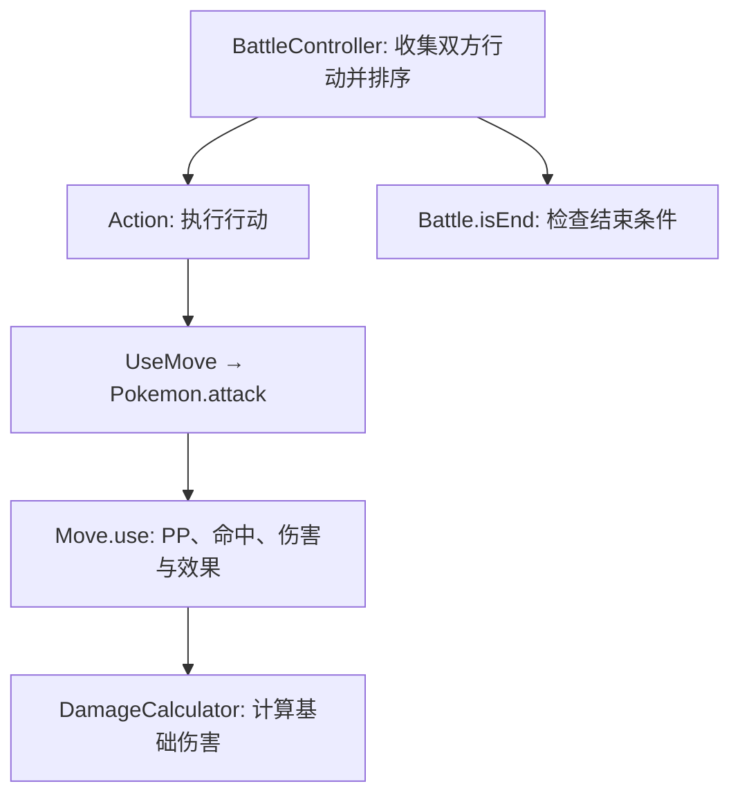

# PokémonGame

一个使用 Java 17 开发的宝可梦回合制游戏原型，包含队伍管理、招式执行、基础伤害计算与回合调度。

**当前阶段：基础战斗引擎与工程基础建设。** 已具备基础对战链路，完整游戏流程、GUI、存档和可直接游玩的 Demo 仍在规划中。

## 已实现功能

- **宝可梦与队伍**：物种配置、性格与个体值、能力值计算、最多六只的队伍、主动换人和基础复制隔离。
- **回合调度**：双方先选择行动，按优先级与速度执行，跳过已濒死或已离场者的行动，处理强制换人与结束判定。
- **招式执行**：PP 消耗和恢复、命中与闪避等级、自身目标、能力等级变化及招式扩展钩子。
- **基础伤害**：物理与特殊攻防、85–100% 随机浮动、本系加成、单/双属性克制与免疫。
- **数据工具**：属性克制 CSV 校验与加载、部分招式及特性 JSON 解析和导出。导入规则仍有待修复项。
- **工程基础**：Maven Wrapper、统一依赖版本、JUnit 回归测试、JSON record 导出读取验证。

## 快速开始

先安装 JDK 17，并将 `JAVA_HOME` 指向该 JDK。克隆仓库：

```sh
git clone https://github.com/lez029/Pokemon-Game-In-Word.git
cd Pokemon-Game-In-Word
```

Windows PowerShell：

```powershell
.\mvnw.cmd clean verify
```

macOS / Linux：

```sh
sh ./mvnw clean verify
```

当前推荐通过构建和测试检查战斗引擎。`src/APITest.java` 是访问外部 API 的实验入口，不是完整游戏启动器。

## 开发环境

- JDK 17；构建会检查 Java 主版本，并使用 `--release 17` 编译。
- Maven Wrapper 固定 Maven 3.10.0，无需单独安装 Maven。
- 源码、资源和构建报告使用 UTF-8。
- Jackson 组件由 BOM 2.21.2 协调版本；`org.json` 固定为 20240303；测试使用 JUnit Jupiter 5.13.4。
- 依赖与插件版本以 `pom.xml` 为准，无需手动下载或在 IDE 中添加 JAR。

将 `JAVA_HOME` 指向 JDK 17 的安装目录。首次运行需要联网下载 Maven、插件及依赖；测试自身不会请求外部 API。

## 构建与测试

在项目根目录运行。Windows PowerShell：

```powershell
.\mvnw.cmd --version
.\mvnw.cmd test
.\mvnw.cmd clean verify
```

macOS / Linux：

```sh
sh ./mvnw --version
sh ./mvnw test
sh ./mvnw clean verify
```

`test` 编译全部应用源码并运行测试；`clean verify` 先清理 Maven 构建产物，再编译、测试并生成 JAR。
测试报告位于 `target/surefire-reports/`，JAR 位于 `target/pokemon-game-0.1.0-SNAPSHOT.jar`。
目前 JAR 是普通项目构建产物，尚未提供完整游戏启动入口，也不包含依赖。

保留的 PowerShell 兼容入口执行同一套 Maven 验证：

```powershell
powershell -NoProfile -ExecutionPolicy Bypass -File tests/verify.ps1
```

依赖已缓存后，可使用 `-o` 离线运行。`clean verify` 会一并缓存打包需要的插件；仅运行过 `test` 不保证完整离线构建所需插件都已缓存。

```powershell
.\mvnw.cmd -o clean verify
```

## 项目布局

本次构建迁移保留现有目录，由 `pom.xml` 显式配置：

| 目录 | 用途 |
| --- | --- |
| `src/` | 应用源码，包括解析器及 JSON 导出工具 |
| `tests/` | JUnit 回归测试与验证说明 |
| `resources/` | 属性表和 JSON 数据，构建时复制到 classpath |
| `.mvn/wrapper/` | Maven 版本、发行包地址及校验值 |
| `target/` | Maven 生成的类、报告和 JAR，不纳入版本控制 |

属性表当前仍按 `resources/Type_Chart.csv` 文件路径读取。构建与测试从项目根目录运行；从其他目录运行应用或仅分发 JAR 尚需后续资源加载改造。

## 当前架构

| 模块 | 职责 |
| --- | --- |
| `src/Entity/` | 玩家、宝可梦、背包、招式、属性和性格 |
| `src/Data/` | 物种、招式、特性等配置记录 |
| `src/BattleEngine/` | 回合循环、阵营、战斗动作、伤害计算与结束判定 |
| `src/Tools/` | HTTP 获取、数据解析、读取与导出工具 |

当前主要执行链路：



这是现有结构，并非已完成的分层架构：`Player` 仍包含控制台决策，战斗状态的归属也需要继续整理。
后续计划通过 `ActionProvider` 分离输入决策，并逐步明确长期实体状态与本场战斗状态的边界。

部分已有设计选择：

- `EnumSet<MoveTag>` 表示有限且不重复的招式标签。
- `double[][]` 表示固定规模的属性克制矩阵。
- 招式接受外部传入的 `Random`，伤害计算接受显式随机值，便于验证边界。
- `MoveData` 等 record 区分配置与实例数据，但内部集合不可变约束仍需补齐。

## 测试与验证

当前有三个 JUnit 测试入口：

| 测试 | 已有检查 |
| --- | --- |
| `BattleRegressionTest` | 换人、目标跟随换入者、背包累加、完整基础对战、强制换人和长回合运行 |
| `DamageRegressionTest` | 基础伤害数值、属性克制与免疫、PP、能力等级边界和复制隔离 |
| `JSONDataWriterTest` | 招式 record 的空值、枚举和能力变化列表在 JSON 写入与读取后保持一致 |

前两组仍将多个场景集中在单个测试方法中。下一步是拆分独立用例，并补齐队伍、回合、招式、伤害、换人和结束判定的边界覆盖；目前不宣称完整测试覆盖。
详细命令和适用范围见 [tests/README.md](tests/README.md)。

## 当前限制与后续计划

- EXP 的累计经验与每级需求语义、招式 URL 层级及命中率空值处理仍需修复。
- 同速排序目前使用阵营固定随机值，尚未实现每回合独立决胜；全招式 PP 耗尽尚缺少完整处理。
- 伤害公式尚未完整对齐特定世代的逐步取整，暴击、天气、异常状态、特性和道具效果尚未接入。
- 多种目标类型、野生遭遇与捕获、存档、商店和 GUI 尚未完成。

完整分阶段计划与验证记录见 [TODO.md](TODO.md)。优先补齐正确性与测试，再逐步降低模块耦合和扩展玩法。

## IDE 导入

在 IntelliJ IDEA 中打开根目录的 `pom.xml`，作为 Maven 项目导入，并选择 JDK 17。
依赖统一由 Maven 导入；不要再手动添加下载目录中的 JAR。
已有 IntelliJ 项目完成旧依赖清理后，使用 Maven 工具窗口中的 Reload All Maven Projects 重新同步。
若尚未出现 Maven 工具窗口，可右键根目录的 `pom.xml`，选择 Add as Maven Project。
IDE 的 `.iml` / `.idea` 属于本机配置，不纳入版本控制；其他电脑应从 `pom.xml` 导入，重新选择本机 JDK 17。

已在本机独立目录验证：仅复制源码、测试、资源和 Maven 构建文件，不携带 IDE 配置、已有编译产物或手动 JAR，使用空 Maven 依赖仓库下载后完成 `clean verify`。该检查不等同于在其他操作系统上实测。

## 路线图

长期技术路线与完成状态见 [TODO.md](TODO.md)。
